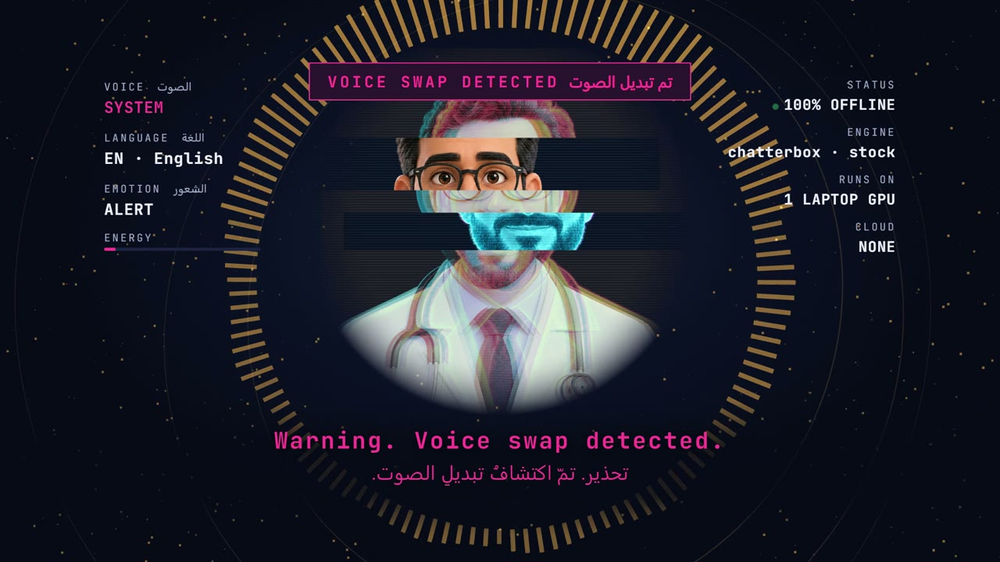

# Arabic Voice Studio

[](https://github.com/Karthus3560/arabic-voice-studio/releases/tag/v1.0)

**▶ Watch the demo:** [1080p](https://github.com/Karthus3560/arabic-voice-studio/releases/download/v1.0/arabic-voice-studio-demo-1080p.mp4) · [720p for phones](https://github.com/Karthus3560/arabic-voice-studio/releases/download/v1.0/arabic-voice-studio-demo-720p.mp4)

Emotive Arabic text-to-speech in a cloned voice, **100% offline**. One script, many feelings: calm, warm, sad, hype, surprised, plus real laughs and chuckles in the same voice. Ships as a Claude Code skill (`/arabic-voice-studio`).

> Chatterbox speaks Arabic but has no `[laugh]` tag and one emotion per clip. This splits the script into segments, gives each its own emotion, and splices in non-verbal sounds from Chatterbox Turbo using the same voice reference.

## What you need

| | |
|---|---|
| GPU | NVIDIA, 6 GB VRAM or more (tested on RTX 4050 Laptop). CPU works, just slowly |
| Python | 3.11 |
| Disk | ~6 GB for models (downloaded on first run from Hugging Face) |
| Tools | `git`, `ffmpeg` |
| Voice | 10-60 s clean recording of the voice to clone, **with the speaker's consent** |
| Optional | Claude Code (to use it as a skill), Node 22 + HyperFrames (for the demo video) |

Nothing is uploaded and nothing costs money after setup.

## Install

```bash
git clone https://github.com/<your-username>/arabic-voice-studio.git
cd arabic-voice-studio

python -m venv .venv
.venv/Scripts/activate            # Windows  (macOS/Linux: source .venv/bin/activate)
pip install torch torchaudio --index-url https://download.pytorch.org/whl/cu124
pip install chatterbox-tts
```

As a Claude Code skill:

```bash
cp -r skill ~/.claude/skills/arabic-voice-studio
```

Then edit the paths at the top of `skill/SKILL.md` to point at your venv and voices folder.

## Make a voice reference

```bash
ffmpeg -i recording.m4a -af "silenceremove=start_periods=1:start_threshold=-45dB,loudnorm=I=-18:TP=-2" -ac 1 -ar 24000 -t 20 voices/speaker.wav
```

## Write a script

`examples/dr-mehdi-demo.json`:

```json
{
  "voice": "voices/speaker.wav",
  "lang": "ar",
  "segments": [
    {"text": "مَرْحَبًا بِكُم!", "emotion": "calm"},
    {"text": "وَالأَجْمَلُ؟ أَنَّهُ يَضْحَكُ أَيْضًا!", "emotion": "hype", "pause": 0.15},
    {"sfx": "[laugh]", "prompt": "[laugh] Ha ha!"},
    {"text": "مَاذَا؟! كُلُّ هَذَا مِنْ عِشْرِينَ ثَانِيَةً فَقَط؟", "emotion": "surprised"}
  ]
}
```

Emotions: `calm`, `normal`, `warm`, `sad`, `hype`, `surprised` (or set `exaggeration` / `cfg` yourself).
Sounds: `[laugh] [chuckle] [gasp] [sigh] [cough] [sniff] [groan] [shush] [clear throat]`.

## Generate

```bash
python skill/scripts/emotive.py examples/dr-mehdi-demo.json -o out.wav --keep-parts
```

You get `out.wav`, `out.timeline.json` (start/end/emotion per line, for captions and lip-sync) and one wav per segment so you can redo a single line by changing its `seed`.

## Tips for clean Arabic
- Short segments (one or two sentences). Long ones drift into repetition.
- Fusha (MSA) with tashkeel on ambiguous words. Dialects work less well.
- Express with `!`, `؟`, `...`. Never stretch letters (`آآآه`).

## Many voices, one clip

Give each voice a name and switch per line. English lines with `[laugh]`-style tags go to Turbo automatically, Arabic lines to the multilingual model:

```json
{
  "voices": {"mehdi": "voices/mehdi.wav", "me": "voices/me.wav"},
  "voice": "mehdi",
  "lang": "en",
  "segments": [
    {"text": "Every voice... tells a story.", "emotion": "calm"},
    {"text": "Mine? Well... [chuckle] it usually starts with a bad joke."},
    {"text": "Wait. That's not his voice anymore.", "voice": "me", "emotion": "surprised"},
    {"text": "أَنَا لَسْتُ هُوَ... أَنَا صَوْتُهُ الجَدِيد.", "voice": "me", "lang": "ar", "caption": "I'm not him... I'm his new voice."}
  ]
}
```

Full example: [`examples/voice-swap-trailer.json`](examples/voice-swap-trailer.json).

### Voices that belong to nobody
No second person to clone? Two ways to get extra voices without borrowing anyone's:
- `"voice": "stock"` uses Chatterbox's built-in voice (the "SYSTEM" alert in the demo).
- Clone a synthetic voice: render ~15 s with a Kokoro preset and use that as the reference. The demo's "NOVA" is `af_nova`:
  ```bash
  npx hyperframes tts "Hello there, I'm Nova..." -v af_nova -o nova-raw.wav
  ffmpeg -i nova-raw.wav -ac 1 -ar 24000 voices/nova-ai.wav
  ```
  NOVA can then laugh, act emotions and speak Arabic like any cloned voice.

## Demo video
`demo/video/` is the [HyperFrames](https://hyperframes.dev) project behind the launch video: a 3D audio-reactive ring, a lip-synced avatar that glitches into a hologram when the voice swaps, a live HUD (voice / language / emotion / engine), and English + Arabic subtitles. Lip-sync and the HUD are driven by the `timeline.json` the generator writes, so a new script re-times the whole video.

```bash
python skill/scripts/emotive.py examples/voice-swap-trailer.json -o demo/voice-swap.wav
cd demo/video
python retime.py ../voice-swap.wav            # re-times subtitles, chips, glitch, sounds, scenes
npx hyperframes preview                       # edit live
npx hyperframes render -o renders/demo.mp4    # final mp4
```

`retime.py` reads the timeline, so your own script drives the whole video: a line with `"voice": "system"` triggers the glitch swap, the first non-English line triggers the language banner, `"caption"` becomes the second-language subtitle, and `[chuckle]` / `[sigh]` / `[laugh]` become pop-up chips and avatar expressions.

Avatar art was generated with ChatGPT's image model (an original character, not a real person).

## Ethics
Clone only voices you have permission to use. Don't make a real person appear to say something they didn't agree to. Chatterbox adds an inaudible AI watermark; keep it.

## Credits
[Chatterbox](https://github.com/resemble-ai/chatterbox) by Resemble AI (MIT). Video with [HyperFrames](https://hyperframes.dev).
